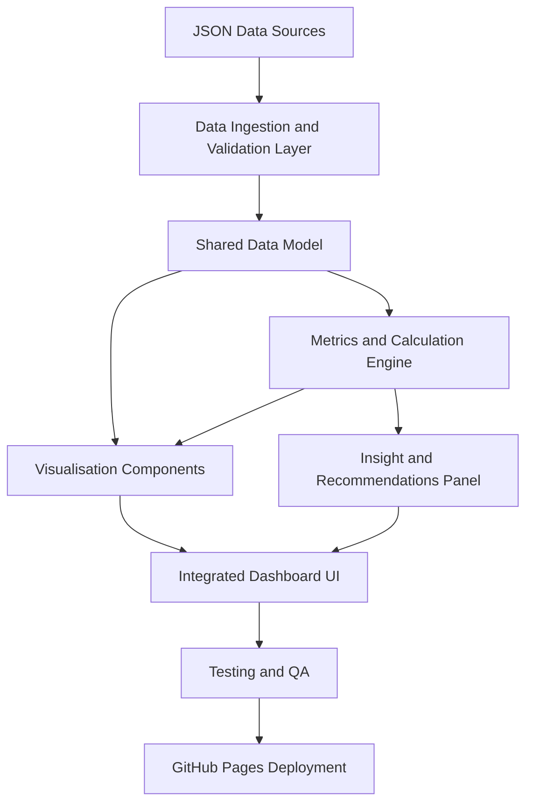

# Mission Clean Orbit

## Project overview
Mission Clean Orbit is a collaborative, browser-based dashboard project designed for FE computing learners and school students. Teams build separate components that combine into a single sustainability-focused dashboard exploring satellites, orbital debris and responsible space operations.

The project develops practical digital skills through applied programming, data handling and user interface design while reinforcing employability behaviours such as teamwork, communication, planning and reflection.

## Workshop scenario
Learners are part of a digital solutions team commissioned to create a prototype dashboard for a fictional Space Sustainability Task Group. The group needs clear, accessible information to:

- monitor satellite and debris indicators,
- understand trends and potential risks,
- communicate findings to non-technical stakeholders,
- suggest actions that support safer, cleaner orbital environments.

Each team takes responsibility for one dashboard area and contributes to a final integrated product.

## Learning objectives
By the end of the workshop, learners should be able to:

- design and develop simple JavaScript features for a real-world brief,
- consume and process JSON data,
- present information through clear visual and textual UI components,
- test and refine functionality,
- collaborate effectively across teams,
- explain technical decisions to peers and teachers,
- connect classroom activity to careers in digital and STEM sectors.

## Team responsibilities
Suggested structure (adapt as needed for class size):

### Team 1: Data Ingestion and Validation
- Load JSON datasets and verify structure.
- Handle missing or inconsistent values.
- Provide clean, shared data objects for other teams.

### Team 2: Metrics and Calculations
- Build reusable JavaScript functions.
- Calculate totals, rates and simple projections.
- Output computed values for visual and narrative components.

### Team 3: Visualisation and UI Components
- Create chart/cards/table sections.
- Apply accessible layout, colour and typography choices.
- Ensure components are readable for mixed audiences.

### Team 4: Insight and Recommendations Panel
- Convert data outputs into short evidence-based recommendations.
- Summarise sustainability implications.
- Draft clear, stakeholder-friendly messaging.

### Team 5: Integration, Testing and QA
- Merge components into one dashboard.
- Check links, events, responsiveness and calculations.
- Coordinate bug fixes and final release readiness.

## Dashboard architecture diagram

## GitHub Pages deployment instructions
1. Push all dashboard files to the repository (for example `index.html`, `styles.css`, `script.js`, and any data files).
2. In GitHub, open **Settings** for the repository.
3. Select **Pages** from the left menu.
4. Under **Build and deployment**, choose:
   - **Source**: *Deploy from a branch*
   - **Branch**: `main` and folder `/ (root)`
5. Save settings and wait for deployment.
6. Open the published URL shown in the Pages section.
7. Test the live site across desktop and mobile browser sizes.

## How each team contributes to the final dashboard
- **Data team** ensures trustworthy, consistent inputs.
- **Calculation team** turns raw values into meaningful indicators.
- **UI team** makes information understandable and accessible.
- **Insight team** adds interpretation and practical recommendations.
- **Integration/QA team** ensures all parts work together as one coherent product.

Together, teams simulate a realistic software delivery workflow where technical and communication outcomes are equally important.

## Suggested 60-minute workshop plan
- **0-10 mins: Introduction and challenge briefing**
  - Introduce orbital debris context and project goals.
  - Share success criteria and expected outputs.

- **10-15 mins: Team assignment**
  - Allocate team roles and clarify deliverables.
  - Confirm communication channels and hand-off points.

- **15-35 mins: Team development**
  - Teams build their assigned components.
  - Teacher circulates for coaching, prompts and formative feedback.

- **35-45 mins: Integration and testing**
  - Combine team outputs into one dashboard.
  - Run functional checks and fix key issues.

- **45-55 mins: Team presentations**
  - Teams explain design choices, technical approach and findings.
  - Class asks questions and offers peer feedback.

- **55-60 mins: Reflection and careers discussion**
  - Review what worked, what could improve and links to industry roles.

## Suggested discussion questions about sustainability and orbital debris
- Why does orbital debris matter for life on Earth?
- Who should be responsible for keeping orbits safe and sustainable?
- How can data help decision-makers prioritise clean-up or prevention actions?
- What are the trade-offs between innovation, cost and sustainability in space activity?
- How might international collaboration improve long-term orbital safety?
- What ethical responsibilities do software and data teams have when presenting risk information?

## Extension activities for students who finish early
- Add a forecasting widget with a clearly explained prediction method.
- Build a filter system (for orbit type, object type or date range).
- Introduce an accessibility improvement pass (contrast, keyboard navigation, labels).
- Add a "data confidence" indicator showing assumptions and data quality caveats.
- Create a second audience mode (technical vs public-facing summary).
- Record a short video walkthrough presenting dashboard insights for non-technical stakeholders.

## Employability, teamwork and digital skills links
Mission Clean Orbit supports:

- **Employability**: communication, ownership, adaptability, time management.
- **Teamwork**: role clarity, collaborative planning, peer review, integration discipline.
- **Digital skills**: coding, data literacy, UI design, testing, version control and deployment.

These are directly relevant to progression routes in computing, digital production and wider STEM careers.
